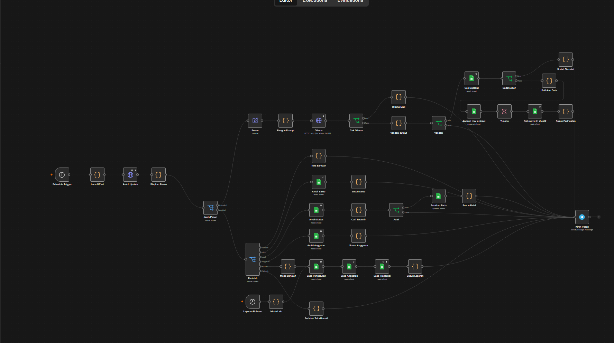
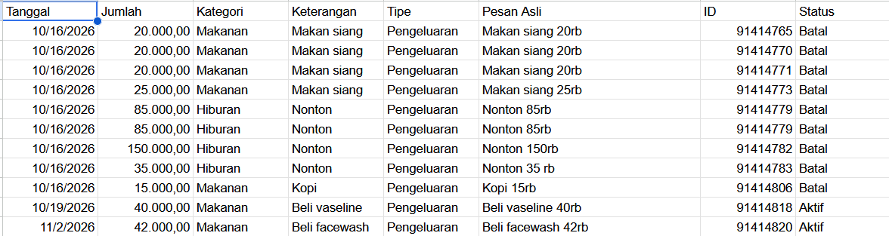
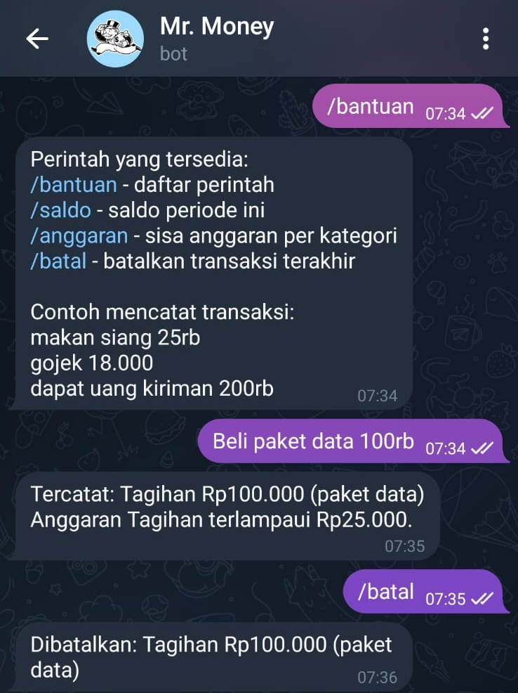
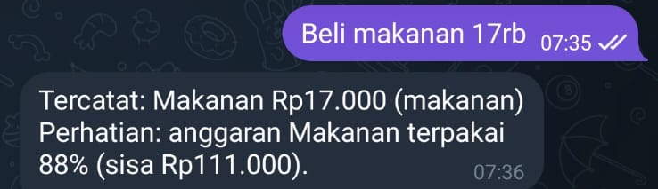
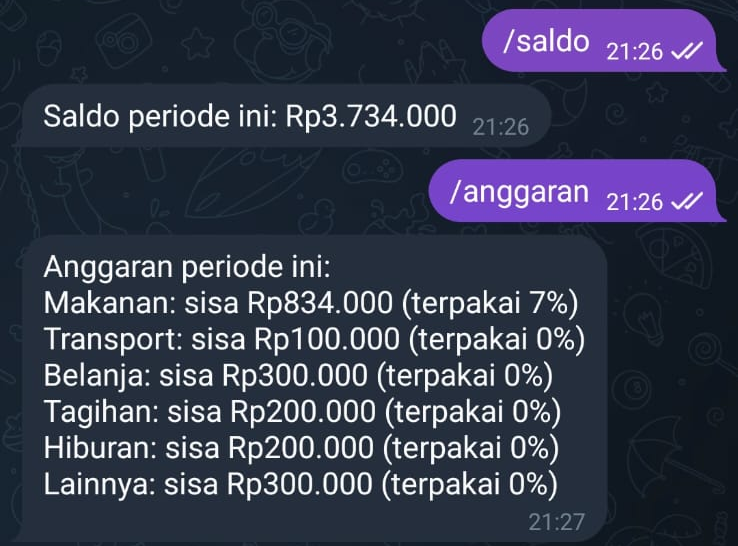

# 💰 AI Money Tracker: Telegram + n8n + Local LLM

Log expenses by just chatting. Send **"makan siang 25rb"** to a Telegram bot, and a **local LLM** turns it into a structured transaction saved in Google Sheets, with budget warnings and monthly reports.

Runs fully on a **CPU-only laptop**; no paid AI API needed.

---

## ✨ Features

- 🗣️ **Natural-language input**: free text like `bensin 50rb` or `gaji 2jt`
- 🤖 **Local AI extraction**: Ollama `qwen2.5:3b` converts messages to JSON (amount, category, type, note)
- ✅ **Validation**: parses `rb` / `jt` amounts, dates, and checks categories before saving
- 📊 **Budget per category** with warnings at **80%** and when the limit is exceeded
- 📅 **Automatic monthly report** sent on the 2nd of each month at 09:00
- ⚠️ **Graceful failure**: replies with a clear message when the local model is offline

### Bot Commands

| Command | Description |
|---|---|
| `/bantuan` | List available commands |
| `/saldo` | Current balance |
| `/anggaran` | Budget usage per category |
| `/laporan` | Report for the current period |
| `/batal` | Cancel the last transaction |

---

## 🏗️ Architecture

```
Telegram message
      │  (polling: getUpdates + offset)
      ▼
┌─────────────┐   ┌──────────────────┐   ┌─────────────────┐
│ Switch:     │──►│ Ollama           │──►│ Code node:      │
│ transaction │   │ qwen2.5:3b       │   │ validation      │
│ or command  │   │ → JSON           │   │ (rb/jt, date,   │
└─────┬───────┘   └──────────────────┘   │  category)      │
      │                                  └────────┬────────┘
      ▼                                           ▼
 Command handlers                        Google Sheets append
 (/saldo, /anggaran,                              │
  /laporan, /batal)                               ▼
      │                                  Budget check → warning
      └──────────────► Telegram reply ◄───────────┘
```

## 🧰 Tech Stack

| Layer | Tool |
|---|---|
| Workflow automation | **n8n** (self-hosted via npm on Windows) |
| AI model | **Ollama** + `qwen2.5:3b` (CPU only) |
| Input | **Telegram Bot API** (polling) |
| Storage | **Google Sheets** (service account) |
| Ops | Windows Task Scheduler + PowerShell (`start-n8n.ps1`) |

### Spreadsheet Structure

- **`Transaksi`**: Tanggal · Jumlah · Kategori · Keterangan · Tipe · Pesan Asli · ID · Status
- **`Anggaran`**: monthly budget limit and amount used per category
- **`Pengaturan`**: settings such as starting balance

The budget period runs from the **2nd of each month**.

---

## 🛣️ Development Phases

| Phase | Scope | Status |
|---|---|---|
| Stage 1 | Telegram → Ollama → validation → Sheets → reply | ✅ |
| Phase 1 | ID & status columns, settings/budget tabs, command routing, `/bantuan`, `/saldo` | ✅ |
| Phase 2 | `/batal`, budget warnings, `/anggaran` | ✅ |
| Phase 3 | `/laporan` + automatic monthly report | ✅ |
| Phase 0 | Auto-start on login, Ollama-down handling, duplicate-ID check, retry on Telegram polling | ✅ |
| Phase 0 | Retry/timeout safeguards on Google Sheets nodes | 🚧 |
| Phase 4 | Debit/credit columns, debts, Obsidian summary | 📝 Planned |

---

## 🐛 Challenges & Fixes

| Problem | Fix |
|---|---|
| n8n in Docker (Linux) couldn't reach Ollama (Windows) on a **dual-boot** laptop: they never run at the same time | Moved n8n to Windows next to Ollama |
| Prompt received `Pesan: undefined` | Read the text directly from the `Siapkan Pesan` node |
| Budget "used" amount stuck at 0 | Dates were stored as text; fixed the column format |
| Sheets returns dates as `MM/dd/yyyy` | Handled the format in the report-building node |
| Intermittent Google Sheets timeouts after auto-start | Forced IPv4-first DNS lookups in `start-n8n.ps1` (`--dns-result-order=ipv4first`) |

---

## 📁 Repository Contents

| Path | What it is |
|---|---|
| `workflow/money-tracker.json` | The n8n workflow export (sanitized) |
| `prompts/extraction-prompt.md` | System prompt sent to Ollama |
| `sheets-template/` | CSV templates for the `Transaksi`, `Anggaran` and `Pengaturan` tabs (dummy data) |
| `scripts/start-n8n.ps1` | Auto-start script for Windows Task Scheduler |
| `docs/improvement-plan.md` | Roadmap and design notes for each phase |

## 🚀 Setup

1. Install **Ollama** and pull the model: `ollama pull qwen2.5:3b`
2. Install **n8n**: `npm install -g n8n`, then `n8n start` (UI at `localhost:5678`)
3. Create a **Telegram bot** with @BotFather and note your own chat ID
4. Create a Google Sheet, import the three CSVs in `sheets-template/` as tabs, and share it with a **Google service account**
5. In n8n: **Import from File** → `workflow/money-tracker.json`
6. Replace the placeholders:
   - `<BOT_TOKEN>` in the `Ambil Update` node URL
   - `<YOUR_CHAT_ID>` in the `Siapkan Pesan` and `Mode Lalu` nodes
   - `<SPREADSHEET_ID>` in every Google Sheets node
7. Add your own **Telegram** and **Google Service Account** credentials to the nodes, then activate the workflow

### Optional: start n8n automatically at logon (Windows)

Copy `scripts/start-n8n.ps1` to `C:\n8n\`, then run in PowerShell:

```powershell
$action  = New-ScheduledTaskAction -Execute "powershell.exe" -Argument '-NoProfile -ExecutionPolicy Bypass -WindowStyle Hidden -File "C:\n8n\start-n8n.ps1"'
$trigger = New-ScheduledTaskTrigger -AtLogOn
Register-ScheduledTask -TaskName "n8n" -Action $action -Trigger $trigger
```

The script sets `NODE_OPTIONS=--dns-result-order=ipv4first` (prevents intermittent Google Sheets timeouts) and the `Asia/Jakarta` timezone so the monthly report fires at the right local time.

> 🔒 **Never commit** your bot token, Telegram chat ID, service-account key file, or real transaction data. Use placeholders and redacted screenshots.

---

## 📸 Screenshots

### n8n workflow


### Google Sheets: `Transaksi` tab
Every message becomes one row. `/batal` sets **Status** to `Batal` instead of deleting the row, so cancelled entries stay auditable.



### Telegram bot

| Logging, over-budget warning, `/batal` | 80% budget warning | `/saldo` and `/anggaran` |
|---|---|---|
|  |  |  |

---

*Part of my Obsidian "second brain" project, and my first portfolio piece for n8n automation.*

---

## 📄 License

Released under the [MIT License](LICENSE).
